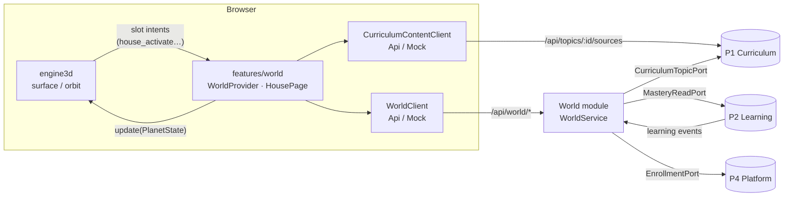
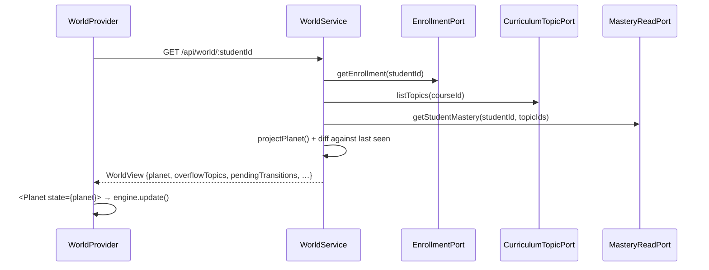
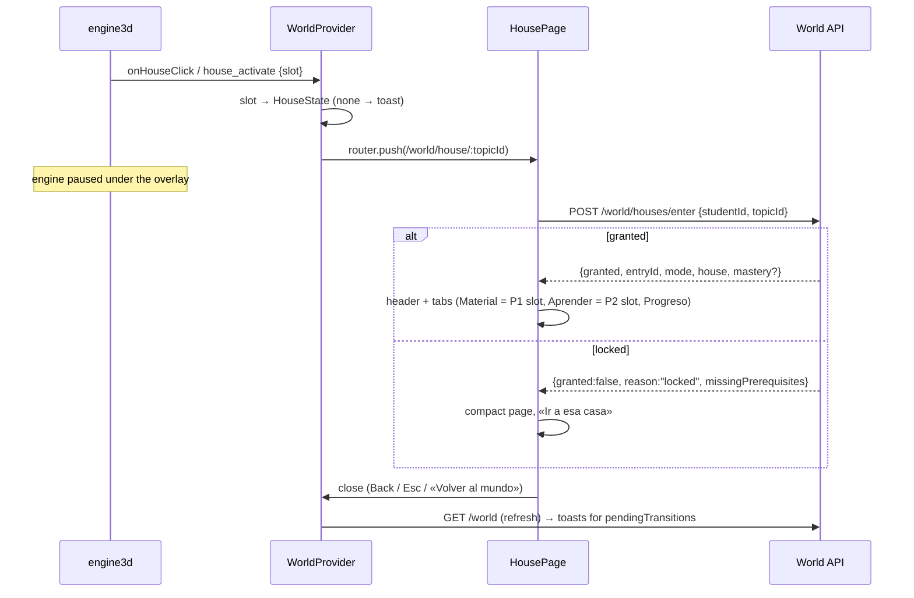
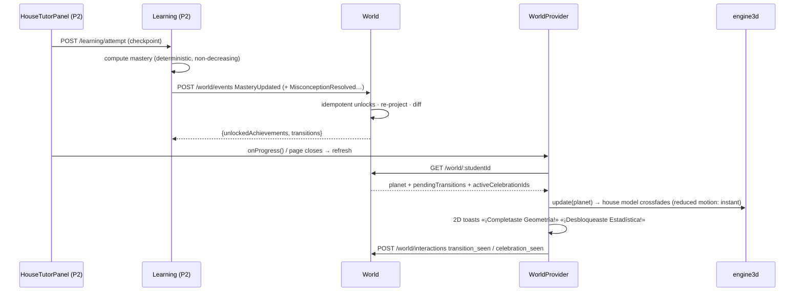

# World integration: how the 3D world talks to the API

> PROPOSAL for team review, not frozen. Owner: World (Subsystem 3). Built on
> `feat/athena-asset-swap-0czegu`. Contract packages:
> [P1 Curriculum](contracts/P1-curriculum-world.md) ·
> [P2 Learning](contracts/P2-learning-world.md) ·
> [World API](contracts/world-api.md).

## Scope

A professor publishes content, and it becomes a house that students walk to, open and read.
Student progress (from Learning) changes each house's state and unlocks the next houses.
Tutoring, checkpoints and the real content pipeline belong to P1 and P2. World defines the
seams, ships mocks that behave like the real thing, and runs end to end in mock mode.

## Who decides what

| Concern                                                            | Owner         | How World uses it                                                                                                                   |
| ------------------------------------------------------------------ | ------------- | ----------------------------------------------------------------------------------------------------------------------------------- |
| Topics, order, prerequisites, uploads, publishing, material        | P1 Curriculum | reads through `CurriculumTopicPort`; the house page mounts P1's `HouseContentPanel`                                                 |
| Mastery, sessions, checkpoints, hints                              | P2 Learning   | reads through `MasteryReadPort`; receives learning events at `POST /api/world/events`; the house page mounts P2's `HouseTutorPanel` |
| Enrollment (student → class → course), auth                        | P4 Platform   | reads through `EnrollmentPort`                                                                                                      |
| Topic → house slot, house state, entry gate, transitions, presence | **World**     | owns (`shared/src/world-integration.ts`, `backend/modules/world`)                                                                   |
| Rendering, proximity, house model per state, crossfade             | engine3d      | pure renderer: gets `PlanetState`, emits slot intents                                                                               |

Invariants:

- World never writes mastery or topics.
- Opening a house, talking to an NPC, Easter eggs and other interactions are never learning
  evidence.
- The engine never fetches data or decides access.

## Layers



In mock mode (`NEXT_PUBLIC_USE_MOCKS=true`), `MockWorldClient` runs the **same**
`WorldService` in the browser on mock ports, so mock and API modes follow identical rules.

## Topic → house assignment

- `slot = topic.order`. P1 guarantees `order` is unique per course, so a house keeps its slot.
- `WORLD_HOUSE_SLOT_COUNT = 6` must equal the engine's `houseInteractionAnchors.length`
  (`frontend/engine3d/tests/world-slots.test.ts`).
- Only `published` topics appear. Topics with `order >= 6` go to `WorldView.overflowTopics`:
  they show in the 2D list only, and you can enter them the same way.
- A slot with no topic shows an empty plot. Activating it shows «Esta casa aún no tiene
  contenido».
- Professors can check the placement with `GET /api/courses/:courseId/world-layout`.

## House states (projection, `projectPlanet` in shared)

```
(no topic) ──P1 publishes──▶ locked ──all prerequisites mastered──▶ available
available ──first evidence (mastery > 0)──▶ in_progress ──mastery ≥ threshold──▶ done
```

Rules are evaluated in this order:

1. mastery ≥ the topic's `masteryThreshold` → `done`
2. mastery > 0 → `in_progress`
3. any prerequisite below its own threshold, or not published → `locked`
4. otherwise → `available`

Also:

- `progress` = mastery.
- `growth` = Learning's value when provided, else the mean house progress.
- Mastery never decreases, and a house with evidence never re-locks: if the professor adds a
  prerequisite later, students who already started keep access.

| State         | 3D (engine, already built)     | Marker / 2D list | Activate opens                                        | Lumen                               |
| ------------- | ------------------------------ | ---------------- | ----------------------------------------------------- | ----------------------------------- |
| empty slot    | empty plot                     | not listed       | toast «Esta casa aún no tiene contenido»              | —                                   |
| `locked`      | `athena-house-locked-v<n>.glb` | ◇ Bloqueado      | compact page: missing prerequisites + «Ir a esa casa» | —                                   |
| `available`   | `…-available-…`                | ⌂ Disponible 0%  | house page, Material tab, CTA «Comenzar»              | waits at the lowest available house |
| `in_progress` | `…-in-progress-…`              | ◐ En progreso n% | house page, last-used tab, CTA «Continuar»            | waits here if none available        |
| `done`        | `…-done-…`                     | ✓ Completado     | house page with «Repaso» banner, CTA «Repasar»        | —                                   |

Symbols, labels and model files come from `houseStateVisuals` in `@athena/brand`. Color is
never the only signal.

## Use cases

### UC1. Professor publishes content (P1; World reacts)

```mermaid
sequenceDiagram
  actor Prof as Professor
  participant P1 as Curriculum (P1)
  participant W as World
  Prof->>P1: POST /courses/:id/materials (upload)
  P1->>P1: extract → chunk → embed → ready
  Prof->>P1: POST /topics/:id/publish {publish:true}
  Note over P1: 409 unless a material is ready
  P1-->>W: TopicPublished (optional; World projects on read)
  Note over W: next GET /world shows the new house,<br/>transition from "absent"
```

### UC2. Student loads the world



### UC3. Student opens a house (3D or 2D list)



**Reach rule.** In 3D a house can only be entered from up close: within the anchor's
interaction radius (2.2 units, measured to the anchor or the house door). The engine computes
this once (`ProjectedHouse.inReach`) and uses it for both the E key and the marker. Far
markers are wayfinding labels only; clicks pass through to the world so the avatar walks
there. The 2D topic list remains the accessible alternative (keyboard and screen readers)
and is intentionally not distance-gated.

The entry is logged as a cosmetic `house_opened` visit. The server re-checks the gate; the
client's gate is only a UX shortcut.

### UC3b. The house page

A pop-up that behaves like a page. It is a Next.js intercepting route
(`app/world/@house/(.)house/[topicId]`), so the URL changes, Back closes it and the world
stays mounted. A hard load renders the standalone page (`app/world/house/[topicId]`).
Desktop: a sheet up to 1100px wide. Mobile: full screen. Behavior: focus trap, Esc closes,
and the title receives focus. Brand tokens only.

```
┌──────────────────────────────────────────────────────────────┐
│ ← Volver al mundo                          [◐ En progreso]   │
│ Geometría                                                    │
│ 2 de 5 conceptos   ▓▓▓▓░░░░░░ 40%                            │
│ Siguiente: Practicar el área de triángulos                   │
├──────────────────────────────────────────────────────────────┤
│  [ Material ]  [ Aprender ]  [ Progreso ]                    │
├──────────────────────────────────────────────────────────────┤
│  Material  → <HouseContentPanel>  (P1)  summary, PDFs, resources│
│  Aprender  → <HouseTutorPanel>    (P2)  placeholder for now  │
│  Progreso  → <HouseProgressPanel> (World) concepts, quest, badges│
└──────────────────────────────────────────────────────────────┘
```

### UC4. Content changes while the student is in the world

`WorldProvider` refetches on window focus, when a house page closes and every 30 s (demo).
New houses appear through `engine.update()`. There are no websockets for now.

### UC5. Overflow and empty slots

See [Topic → house assignment](#topic--house-assignment).

### UC6. Professor checks placement

`GET /api/courses/:courseId/world-layout` returns the slots, the topic in each slot and the
overflow. P1's professor UI can show "this topic will be house #3".

### UC7. Progression and unlocks



Duplicate events unlock nothing and queue no transition. Acknowledged transitions never
replay.

**Demo without P2.** Open `/world?presenter=1`; the button calls `POST /api/demo/world/step`
(or the in-browser driver in mock mode). Each step writes the next mastery value into the
mock Learning port and sends its events through the real sink:

1. `SECOND_CHECKPOINT_PASSED`: Geometría 40 → 60%, «Primera luz» badge.
2. `GEOMETRY_MASTERED`: Geometría ✓, Estadística ◇ → ⌂.

The demo routes do not exist when `NODE_ENV=production`.

## Demo data (shared fixtures)

- `demoCurriculumTopics` (prerequisites):
  - Fracciones → Geometría, Funciones
  - Geometría → Estadística → Probabilidad
  - Funciones + Probabilidad → Pensamiento crítico
- `demoClassMastery` reproduces `demoClassPlanets` exactly through the projection (tested).
  To keep the planets consistent with these prerequisites, two fixtures changed: Valentina's
  Funciones and Santiago's Estadística are now `available`.

## Requests to other owners

- **Carlos / engine3d:**
  - Emit `EngineEvent`s (`frontend/engine3d/src/events.ts`) from `surface.ts`.
  - Add `focusHouse(slot)` for «Ir a esa casa».
  - Today the web layer maps `onHouseClick` to `activate`, so nothing is blocked.
- **P1:**
  - Implement the [curriculum contract](contracts/P1-curriculum-world.md) and swap
    `MockCurriculumTopicPort` / `MockCurriculumContentClient`.
  - Own `HouseContentPanel` internals.
- **P2:**
  - Implement the [learning contract](contracts/P2-learning-world.md): the mastery read, and
    calling `POST /world/events` after each mastery change.
  - Own `HouseTutorPanel`.
- **P4:**
  - Implement `EnrollmentPort`.
  - Protect `POST /world/events` (service-to-service).
  - Replace `DEMO_STUDENT_ID` with the signed-in student.

## Open questions

- Growth: Learning-provided or the mean of house progress (current fallback)?
- Should `topicSchema` (proposal 3.2) gain `published`, or should that be a separate
  visibility table?
- There are two fixture sets: `mocks.ts` (orbit, `student-1..8`) and `world.ts` (Lucía).
  Their professor ids also differ (`prof-ruiz` vs `prof-elena-ruiz`). Pick one.
- Should new achievements without a 3D celebration (e.g. `geometry-builder`) also toast?
- World state is in memory: persisting `seenHouses`/`transitions` needs P4 tables.
